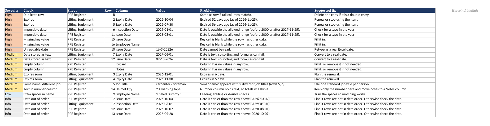

# Register Health-Check (Python)

A small script that reads an Excel register (PPE, training, lifting equipment, transmittals and similar) and lists data problems for you to review: expired dates, impossible dates, duplicate rows, missing values, dates stored as text, and names that do not match. It writes a **separate report** and never changes your file. Needs Python and one package (`openpyxl`). Dummy example data only.

## Walkthrough (English)

1. Install Python 3, then run once: `pip install openpyxl`
2. Keep a copy of your register in a folder with `healthcheck.py`. Try `sample/dummy_register.xlsx` first.
3. Run: `python healthcheck.py sample/dummy_register.xlsx --as-of 2026-11-25`
4. Open `sample/dummy_register_health_report.xlsx` (a ready-made copy is in `sample/example_report.xlsx`). The **Summary** sheet counts issues per sheet. The **Issues** sheet lists each one with the sheet, the real Excel row, the column, the value, the problem and a suggested fix. Filter by Severity.
5. Fix the problems in your own file, then run again.
6. The exit code is 0 when no High issues are found, 1 when there are High issues, and 2 on an error (missing file, wrong file type, report already exists).

Common options: `--sheet "PPE Register"`, `--warn-days 10`, `--min-year 2000`, `--max-future-days 365`, `--expiry-max-years 10`, `--month-first` (read 03/04/2026 as March 4), `--out report.xlsx`, `--force` (replace an existing report). Without `--as-of` it uses today's date.

Run the tests: `python -m unittest discover -s tests` (25 tests).

## What it checks

| Check | Severity |
|---|---|
| Expired date in an expiry column | High |
| Impossible date (before the minimum year or too far ahead) | High |
| Date text that cannot be read | High |
| Exact duplicate row | High |
| Blank name or date in a row that has data | High |
| Date stored as text | Medium |
| Expires within the warning days | Medium |
| Empty column, or an ID column that is mostly empty | Medium |
| Same name with different job titles | Medium |
| Text inside a quantity column | Medium |
| Same person and same date twice | Low |
| Extra spaces in a name | Low |
| Date earlier than the row above | Info |

Columns are found from header words in English or Arabic (for example Date / تاريخ, Expiry / انتهاء, Name / الاسم, Job / المهنة, Qty / العدد, ID / رقم البطاقة). The header row is the row with the most text in the first 15 rows.

## الشرح بالعربي

السكريبت ده بيقرأ ريجستر Excel (مهمات وقاية، تدريب، معدات رفع، ترانسميتال وغيرها) ويطلعلك قائمة مشاكل في البيانات تراجعها: تواريخ منتهية، تواريخ مستحيلة، صفوف مكررة، خانات ناقصة، تواريخ مكتوبة كنص، وأسماء مش متطابقة. بيطلع **تقرير منفصل** ومش بيغيّر ملفك. محتاج Python ومكتبة `openpyxl`. بيانات المثال وهمية.

1. نزّل Python 3 وشغّل مرة واحدة: `pip install openpyxl`
2. حط نسخة من الريجستر في فولدر فيه `healthcheck.py`. جرّب الأول `sample/dummy_register.xlsx`.
3. شغّل: `python healthcheck.py sample/dummy_register.xlsx --as-of 2026-11-25`
4. افتح `sample/dummy_register_health_report.xlsx` (نسخة جاهزة منه في `sample/example_report.xlsx`). شيت **Summary** فيه عدد المشاكل لكل شيت، وشيت **Issues** فيه كل مشكلة باسم الشيت ورقم الصف الحقيقي في Excel والعمود والقيمة والمشكلة والحل المقترح. فلتر على الـ Severity.
5. صلّح المشاكل في ملفك انت، وبعدها شغّل السكريبت تاني.
6. كود الخروج 0 لو مفيش مشاكل High، و1 لو فيه High، و2 لو فيه خطأ (ملف مش موجود أو نوع غلط أو التقرير موجود قبل كده).

خيارات مفيدة: `--sheet` لشيت واحد، `--warn-days` لعدد أيام التنبيه قبل الانتهاء، `--min-year` و`--max-future-days` لحدود التواريخ، `--month-first` لو التواريخ النصية بالشهر الأول، `--out` لاسم التقرير، `--force` لو عايز تستبدل تقرير موجود. لو ما كتبتش `--as-of` بيستخدم تاريخ النهاردة.

كل تقرير فيه علامة رمادية خفيفة باسم Hussein Abdallah (في شيت Summary وشيت Issues وتذييل الطباعة). العلامة بتوضح مين عمل الأداة، لكنها نص عادي جوه الملف وأي حد يقدر يمسحها، ومش بتقفل الملف ولا بتحميه.

**تنبيه مهم:** الريجسترات الحقيقية فيها أسماء ناس وبيانات شركة. شغّل السكريبت على جهازك بس، وما ترفعش ملف حقيقي ولا تقرير منه على GitHub. المثال هنا كله بيانات وهمية.

## Limits

- Findings are leads to review. A flagged row may be correct.
- Every report carries a light grey "Hussein Abdallah" mark (Summary sheet, Issues sheet and the print footer). It shows who made the tool. It is plain text inside the file, so anyone can delete it. It does not lock or protect the file.
- It reads the values saved in the file. If a file has formulas that Excel never calculated, those cells look empty. The report warns about this: open the file in Excel, save it, and run again.
- The report writes text that starts with `=`, `+`, `-` or `@` as plain text, so Excel does not run it as a formula. This is covered by a test.
- Tested only with Python 3.10 on Linux, on the dummy files and small test files. Not tested on Windows, in desktop Excel, or on large real registers.
- Merged cells, several tables on one sheet, hidden rows, and unusual headers can confuse the column detection.
- Text dates are read day first (16-3-2026) unless you pass `--month-first`.
- It does not fix anything. It does not read cell colours or comments, and it does not check that a certificate or equipment item is valid in real life.
- The "date earlier than the row above" check is only Info and can be noisy if the register is not sorted by date.

## Notice (see NOTICE.md)

© 2026 Hussein Abdallah. All rights reserved.
