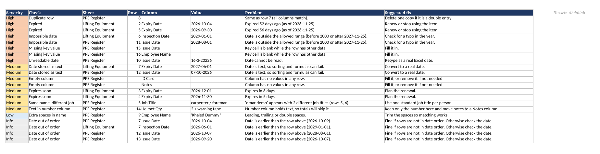
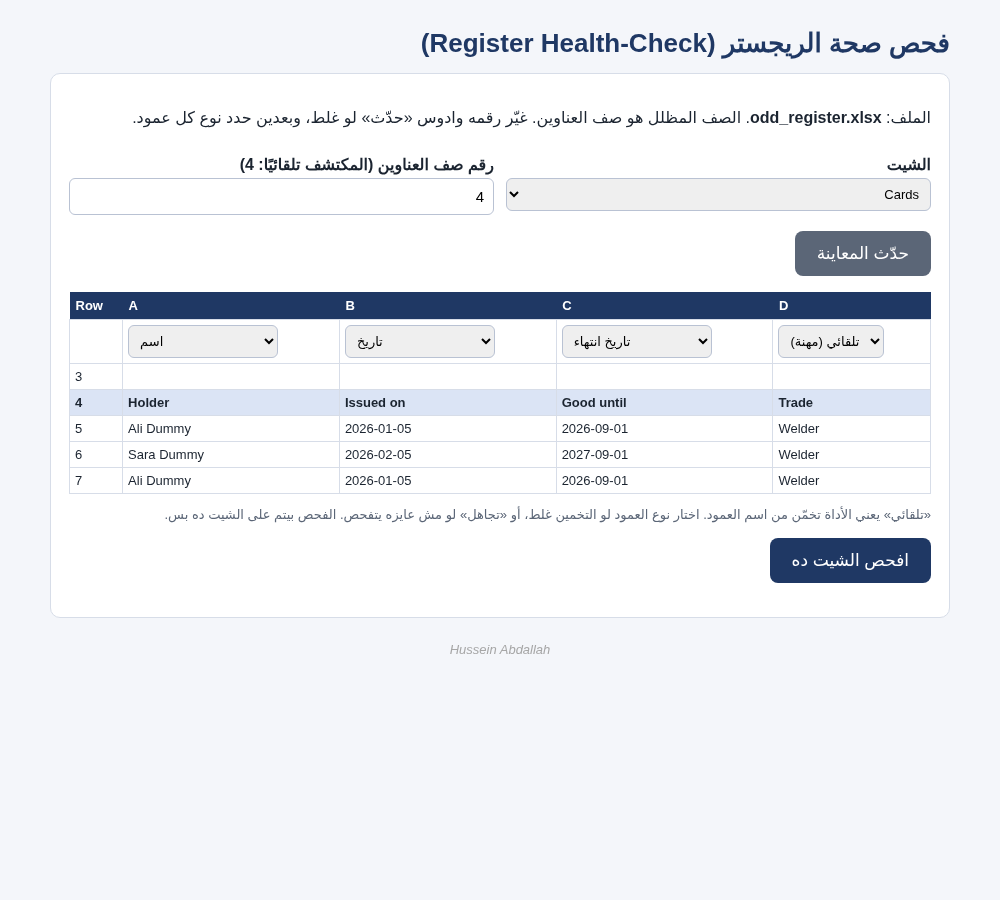

# Register Health-Check (Python)

A small script that reads an Excel register (PPE, training, lifting equipment, transmittals and similar) and lists data problems for you to review: expired dates, impossible dates, duplicate rows, missing values, dates stored as text, and names that do not match. It writes a **separate report** and never changes your file. Needs Python and one package (`openpyxl`). Dummy example data only.

## Walkthrough (English)

1. Install Python 3, then run once: `pip install openpyxl`
2. Keep a copy of your register in a folder with `healthcheck.py`. Try `sample/dummy_register.xlsx` first.
3. Run: `python healthcheck.py sample/dummy_register.xlsx --as-of 2026-11-25`
4. Open `sample/dummy_register_health_report.xlsx` (a ready-made copy is in `sample/example_report.xlsx`). The **Summary** sheet counts issues per sheet. The **Issues** sheet lists each one with the sheet, the real Excel row, the column, the value, the problem and a suggested fix. Filter by Severity.
5. Fix the problems in your own file, then run again.
6. The exit code is 0 when no High issues are found, 1 when there are High issues, and 2 on an error (missing file, wrong file type, report already exists).

Common options: `--sheet "PPE Register"`, `--warn-days 10`, `--min-year 2000`, `--max-future-days 365`, `--expiry-max-years 10`, `--month-first` (read 03/04/2026 as March 4), `--header-row 4` and `--role B=name --role D=expiry` (set the header row and column types by hand, needs `--sheet`; roles: auto, date, expiry, name, job, id, qty, ignore), `--out report.xlsx`, `--force` (replace an existing report). Without `--as-of` it uses today's date.

### Simple screen (no commands per file)

Keep `healthcheck.py` and `healthcheck_gui.py` in one folder and run `python healthcheck_gui.py`. A page opens in your browser at `http://127.0.0.1:8765`. Choose an Excel file, set the review date, and press the check button. You see the counts and the issues table and can download the Excel report.

If your register has title rows, or column names the script does not recognise, press **"set the header row and columns myself"**. Pick the sheet, correct the header row number, and set the type of each column (date, expiry date, name, job, ID, quantity, or ignore). Then check that sheet. Try it with `sample/odd_headers_register.xlsx`: in automatic mode it misses the expired dates, and with header row 4 and the columns set by hand it finds them.

The page runs on your own computer only (it listens on 127.0.0.1, nothing goes to the internet). Your file is copied to a temporary folder, checked, and the copy is deleted right after. Stop the program with Ctrl+C in its window.

Run the tests: `python -m unittest discover -s tests` (56 tests).

## Formula check (offline, optional)

Add `--formulas` to also audit the formulas: `python healthcheck.py book.xlsx --formulas`. In the simple screen it is a checkbox, on by default. It reads the formulas and the values Excel saved, never changes your file, and adds the findings to the same report (same Issues sheet). To try it, run `python make_formula_sample.py` (it builds `sample/dummy_formulas.xlsx` with deliberate problems), open and save that file once in Excel so the results are stored, then run `python healthcheck.py sample/dummy_formulas.xlsx --formulas`.

| Check | Severity |
|---|---|
| Cell shows an error (#DIV/0!, #N/A, #VALUE!, #NAME?, #REF!, ...) | High |
| Formula contains #REF! or divides by a literal 0 | High |
| Formula points to a sheet that is not in the file | High |
| Formula refers to its own cell | High |
| Typed number sitting between formulas in a column | High |
| SUM/AVERAGE/COUNT/MIN/MAX range stops one row short of a number | Medium |
| Numbers saved as text inside a SUM/AVERAGE range | Medium |
| Formula differs from the matching formulas above and below | Medium |
| Link to another workbook | Medium |
| Reference to an empty cell | Low |
| INDIRECT, OFFSET, TODAY, NOW, RAND (recalculate on every change) | Info |

Limits of the formula check: it cannot recalculate, so it cannot prove a formula gives the right number; it relies on the values Excel saved (a file never opened in Excel shows a warning). Circular references are found only when a formula includes its own cell, not longer loops. Named ranges, array formulas and other sheets' layouts are not analysed. Findings are leads to review.

## What it checks

| Check | Severity |
|---|---|
| Expired date in an expiry column | High |
| Impossible date (before the minimum year or too far ahead) | High |
| Date text that cannot be read | High |
| Exact duplicate row | High |
| Blank name or date in a row that has data | High |
| Date stored as text | Medium |
| Expires within the warning days | Medium |
| Empty column, or an ID column that is mostly empty | Medium |
| Same name with different job titles | Medium |
| Text inside a quantity column | Medium |
| Same person and same date twice | Low |
| Extra spaces in a name | Low |
| Date earlier than the row above | Info |

Columns are found from header words in English or Arabic (for example Date / تاريخ, Expiry / انتهاء, Name / الاسم, Job / المهنة, Qty / العدد, ID / رقم البطاقة). The header row is the row with the most text in the first 15 rows.

## الشرح بالعربي

السكريبت ده بيقرأ ريجستر Excel (مهمات وقاية، تدريب، معدات رفع، ترانسميتال وغيرها) ويطلعلك قائمة مشاكل في البيانات تراجعها: تواريخ منتهية، تواريخ مستحيلة، صفوف مكررة، خانات ناقصة، تواريخ مكتوبة كنص، وأسماء مش متطابقة. بيطلع **تقرير منفصل** ومش بيغيّر ملفك. محتاج Python ومكتبة `openpyxl`. بيانات المثال وهمية.

1. نزّل Python 3 وشغّل مرة واحدة: `pip install openpyxl`
2. حط نسخة من الريجستر في فولدر فيه `healthcheck.py`. جرّب الأول `sample/dummy_register.xlsx`.
3. شغّل: `python healthcheck.py sample/dummy_register.xlsx --as-of 2026-11-25`
4. افتح `sample/dummy_register_health_report.xlsx` (نسخة جاهزة منه في `sample/example_report.xlsx`). شيت **Summary** فيه عدد المشاكل لكل شيت، وشيت **Issues** فيه كل مشكلة باسم الشيت ورقم الصف الحقيقي في Excel والعمود والقيمة والمشكلة والحل المقترح. فلتر على الـ Severity.
5. صلّح المشاكل في ملفك انت، وبعدها شغّل السكريبت تاني.
6. كود الخروج 0 لو مفيش مشاكل High، و1 لو فيه High، و2 لو فيه خطأ (ملف مش موجود أو نوع غلط أو التقرير موجود قبل كده).

خيارات مفيدة: `--sheet` لشيت واحد، `--warn-days` لعدد أيام التنبيه قبل الانتهاء، `--min-year` و`--max-future-days` لحدود التواريخ، `--month-first` لو التواريخ النصية بالشهر الأول، `--out` لاسم التقرير، `--force` لو عايز تستبدل تقرير موجود. لو ما كتبتش `--as-of` بيستخدم تاريخ النهاردة.

**شاشة بسيطة (من غير أوامر لكل ملف):** حط `healthcheck.py` و`healthcheck_gui.py` في نفس الفولدر وشغّل `python healthcheck_gui.py`. هتفتح صفحة في المتصفح على `http://127.0.0.1:8765`. اختار ملف Excel، وحدد تاريخ المراجعة، وادوس افحص. هتشوف الأعداد وجدول الملاحظات وتنزّل تقرير Excel.

لو الريجستر فيه صفوف عنوان فوق الجدول، أو أسماء أعمدة الأداة مش بتعرفها، ادوس **«اضبط صف العناوين والأعمدة بنفسي»**. اختار الشيت، وصحّح رقم صف العناوين، وحدد نوع كل عمود (تاريخ، تاريخ انتهاء، اسم، مهنة، رقم/كود، كمية، أو تجاهل)، وبعدين افحص الشيت ده. جرّب الملف `sample/odd_headers_register.xlsx`: في الوضع التلقائي مش بيلاقي التواريخ المنتهية، ولما تحدد صف العناوين 4 وتختار الأعمدة بنفسك بيلاقيها. وفي سطر الأوامر الخيارات هي `--header-row` و`--role` (مثلًا `--role B=name`) ولازم معاهم `--sheet`.

الشاشة بتشتغل على جهازك بس (على 127.0.0.1، ومفيش حاجة بتتبعت على الإنترنت). الملف بيتنسخ مؤقتًا وبيتمسح بعد الفحص. وقّف البرنامج بـ Ctrl+C من النافذة اللي شغّلته منها.

كل تقرير فيه علامة رمادية خفيفة باسم Hussein Abdallah (في شيت Summary وشيت Issues وتذييل الطباعة). العلامة بتوضح مين عمل الأداة، لكنها نص عادي جوه الملف وأي حد يقدر يمسحها، ومش بتقفل الملف ولا بتحميه.

**تنبيه مهم:** الريجسترات الحقيقية فيها أسماء ناس وبيانات شركة. شغّل السكريبت على جهازك بس، وما ترفعش ملف حقيقي ولا تقرير منه على GitHub. المثال هنا كله بيانات وهمية.

## فحص المعادلات (أوفلاين، اختياري)

زوّد `--formulas` لو عايز يفحص المعادلات كمان: `python healthcheck.py book.xlsx --formulas`. في الشاشة البسيطة هو مربع اختيار شغال تلقائيًا. بيقرأ المعادلات والقيم اللي Excel حافظها، ومش بيغيّر ملفك، وبيضيف الملاحظات في نفس التقرير (شيت Issues). للتجربة شغّل `python make_formula_sample.py` (بيبني `sample/dummy_formulas.xlsx` فيه مشاكل متعمدة)، وافتحه واحفظه مرة في Excel عشان النتائج تتخزن، وبعدين شغّل `python healthcheck.py sample/dummy_formulas.xlsx --formulas`. .

بيلاقي: خلايا فيها أخطاء (#DIV/0! و#N/A و#VALUE! و#NAME? و#REF!)، معادلة فيها #REF! أو قسمة على صفر، إشارة لشيت مش موجود، معادلة بتشاور على خليتها هي، رقم مكتوب بإيدك وسط معادلات في العمود، نطاق SUM وغيره بيقف قبل صف فيه رقم، أرقام مكتوبة كنص جوه النطاق، معادلة مختلفة عن اللي فوقها وتحتها، رابط لملف تاني، إشارة لخلية فاضية، ودوال بتتغير مع كل حساب (TODAY وNOW وغيرها).

حدود الفحص: الأداة مش بتعيد حساب المعادلات، فمش بتثبت إن الناتج صح رقميًا، وبتعتمد على القيم اللي Excel حافظها (لو الملف عمره ما اتفتح في Excel هتظهر تحذير). الدوائر المقفولة بتتلقط بس لو المعادلة فيها خليتها هي، مش الدورات الأطول. والنتيجة ملاحظات للمراجعة مش قرارات نهائية.

## Limits

- Findings are leads to review. A flagged row may be correct.
- Every report carries a light grey "Hussein Abdallah" mark (Summary sheet, Issues sheet and the print footer). It shows who made the tool. It is plain text inside the file, so anyone can delete it. It does not lock or protect the file.
- It reads the values saved in the file. If a file has formulas that Excel never calculated, those cells look empty. The report warns about this: open the file in Excel, save it, and run again.
- The report writes text that starts with `=`, `+`, `-` or `@` as plain text, so Excel does not run it as a formula. This is covered by a test.
- Tested only with Python 3.10 on Linux, on the dummy files and small test files. Not tested on Windows, in desktop Excel, or on large real registers.
- The simple screen was tested here only with Python 3.10 on Linux and Chrome, on dummy files. Not tested on Windows or Mac, with other browsers or Python 3.12+, with the operating system's file dialog, or on large real registers (the upload limit is 50 MB).
- Manual column setup works on one sheet at a time and does not fix merged header cells, headers spread over two rows, or several tables on one sheet. "Ignore" turns a column off for all checks.
- Merged cells, several tables on one sheet, hidden rows, and unusual headers can confuse the column detection.
- Text dates are read day first (16-3-2026) unless you pass `--month-first`.
- It does not fix anything. It does not read cell colours or comments, and it does not check that a certificate or equipment item is valid in real life.
- The "date earlier than the row above" check is only Info and can be noisy if the register is not sorted by date.

## Notice (see NOTICE.md)

© 2026 Hussein Abdallah. All rights reserved.
